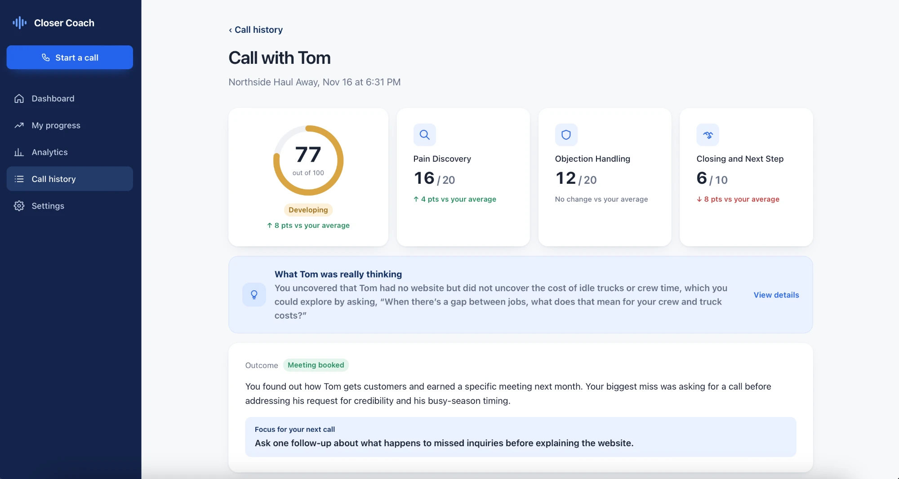
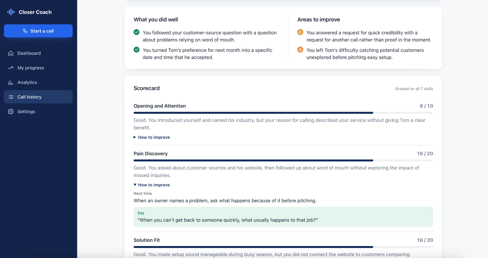
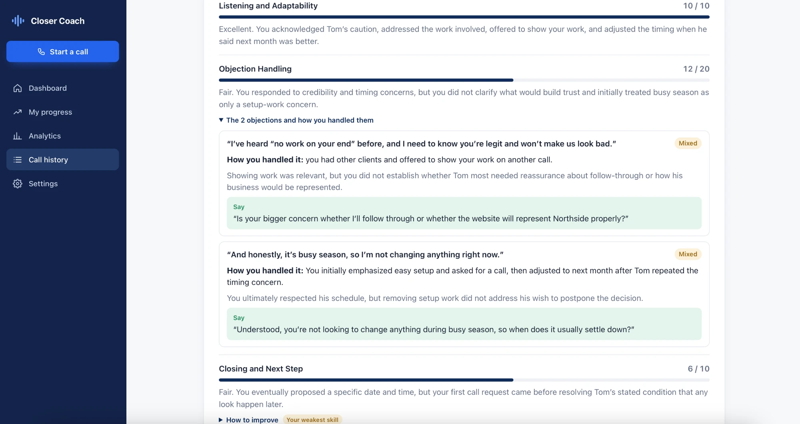
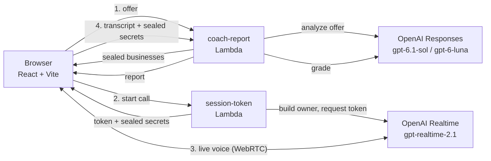

# CloserCoach

**Live app:** https://main.d35wias2tzhiw9.amplifyapp.com/

No login. Open it, describe what you sell, and start a call. Works best on a laptop in Chrome with a microphone.

**Stack:** React 19 + Vite · AWS Amplify Gen 2 (hosting + two Lambda functions) · OpenAI Realtime voice (`gpt-realtime-2.1`) with live transcription (`gpt-4o-mini-transcribe`) · OpenAI Responses API (`gpt-6.1-sol` grader, `gpt-6-luna` offer analysis)

Keegan Eichert, CUA Busch School AI Vibe Coding Contest, Fall 2026

---

## In two sentences

CloserCoach is for solo entrepreneurs, freelancers and small agency owners who sell services to small businesses and have to win their own clients, often by cold calling. It lets them practice a real phone call out loud against an AI business owner who reacts to their actual offer, then gives them an honest coaching report, tied to what was actually said on the call, the moment they hang up.

## Try it in two minutes

1. **See a full dashboard without making a call:** on the Dashboard, click **Show sample scores**. This loads 30 made-up calls so you can browse My progress, Analytics, Call history and a full report. A yellow notice marks them as samples, and **Remove them** clears them.
2. **Make a real call:** click **Start a call**, fill in what you sell, who you sell to and the price (for example: *Websites*, *home service businesses*, *$77/month*), then click **Start call** and allow the microphone.
3. **Talk to the owner** for up to 5 minutes. Ask about their business before you pitch, then try to book a meeting.
4. **Hang up** and read your report. It takes about 20 to 30 seconds.

## Why I built it

This past summer I tried to start a side business selling websites to local businesses with dated sites or none at all. What held me back was not the product. It was fear. I knew what to say in theory, but I froze at the thought of a real owner pushing back on the phone, and the only place to practice was on real prospects, which burns leads.

Practicing with a friend does not work well either. They do not know the business, they go easy on you, and they cannot tell you exactly what went wrong. I wanted something that would let me take the hard calls in private, as many times as I needed, and tell me specifically what to fix before the next one.

## Who it is for

**Solo entrepreneurs, freelancers and small agency owners who sell a service to small businesses:** web designers, marketing and SEO agencies, AI automation consultants, IT and software builders.

More people than ever are starting service businesses on their own. AI tools let one person build and deliver what used to take a team, but nothing does the selling for them. There is no sales manager, no team to role-play with, and no one to tell them why a call went wrong. Every client has to be won by the founder, and every bad call burns a real prospect. CloserCoach gives that person a place to practice the call before it counts.

It also works for **business students and new sales reps** learning to cold-call small business owners for the first time.

The typical user is one person practicing alone before a real call, usually on a laptop between client work.

## How a practice call works

1. **Describe your offer.** What you sell, who you sell to, the price, and any terms (contract, guarantee). Every owner you call is built around this.
2. **Start the call.** A small business owner picks up and talks back to you in a natural voice. You have up to 5 minutes.
3. **Have the conversation.** The owner has real problems in their business but will not hand them to you. You have to ask good questions to find them, connect what you sell to what they tell you, handle their pushback, and ask for a next step.
4. **Hang up and read your report.** A score out of 100 across seven skills, with the specific moment from the call behind every rating, a card for each objection (quoting the owner's exact words) with a better line to say, and a reveal of what the owner was secretly dealing with.
5. **Watch yourself improve.** *My progress* compares your last 5 calls with the 5 before and names the one skill to work on next. *Analytics* shows your scores, outcomes and the objections you struggle with. *Call history* keeps every report and transcript so you can review past calls at any time.

## What a report looks like

These are from one of my own practice calls: selling websites to Tom, who runs a junk removal company.

**The score, the three headline skills, and what Tom was really thinking.**



**What went well, what to fix, and how each skill was graded,** with a habit to build and the exact words to try next time.



**Each objection Tom raised,** in his own words, how I handled it, and a better line to say.



## What the AI does (and why a checklist could not)

CloserCoach uses AI for four separate jobs, each with its own model and its own guardrails.

| Job | Model | What it does |
|---|---|---|
| **Build the businesses** | `gpt-6-luna` | Reads your offer and invents small businesses that would plausibly buy it, with specific problems your product could solve. A website seller gets a plumbing company that relies on word of mouth; a missed-call service gets a roofer who cannot answer the phone on a roof. |
| **Play the owner** | `gpt-realtime-2.1` | Holds a live spoken conversation in character and reacts to what you actually say. The owner waits for you to finish (a 1.2-second pause) before answering, so stopping to think does not end your turn. |
| **Write down the call** | `gpt-4o-mini-transcribe` | Turns your side of the call into text as you speak. This transcript is what gets graded, and you can read it under every report. |
| **Grade the call** | `gpt-6.1-sol` | Reads the transcript and rates each skill against a fixed rubric, pointing to what you actually said, and writes a better line for every objection. |

**The owners are not one big prompt.** Each call's owner is assembled by plain code (`amplify/functions/session-token/scenario.ts`) from:

- one of **5 owners** (Dave, Maria, Tom, Linda, Mike), each with a male or female voice;
- one of **6 personalities** (Skeptic, Busy Owner, Friendly Owner, Analytical, Old School, Penny-Pincher), each a range over **8 traits** (patience, skepticism, friendliness, directness, numbers, openness, talkativeness, decisiveness), so two Skeptics still differ;
- **hidden problems and concerns** that come from the business itself, plus smaller concerns from the personality. Owners do not volunteer their problems; the rep has to earn them with good questions.

Why split it this way? With rules alone, the owner would be a scripted phone tree. With one big prompt, the owner tends to be too easy, forget what they said, or hand you the answer. In CloserCoach the code decides *who* the owner is and what they are hiding, and the model decides *how they talk*. Because the code is plain rules, it can be tested: the unit tests build thousands of owners and check that every one follows the rules (for example, every owner has at least one concern that comes from their business).

**The AI rates; the code scores.** The grader only picks a rating for each skill (0 to 4, or N/A) and gives its reason, based on what was said on the call. The points, total, grade band and filler-word count are computed by code (`amplify/functions/coach-report/grading.ts`), so the numbers always add up and the same ratings always produce the same score.

## The grading rubric

| Skill | Points | What it checks |
|---|---|---|
| Opening and Attention | 10 | A clear intro and a specific reason this business should listen |
| Pain Discovery | 20 | Questions that uncover the owner's real problems before pitching |
| Solution Fit | 20 | Tying the offer to what the owner said, in their words, with honest claims |
| Listening and Adaptability | 10 | Changing course based on what the owner just said |
| Objection Handling | 20 | Acknowledging the concern, finding the real worry behind it, and answering that |
| Closing and Next Step | 10 | Asking for a small, specific next step once interest is earned |
| Delivery | 10 | Clear, concise answers (7 points, rated by AI) and filler words per 100 words (3 points, counted by code) |

Grade bands: 90+ Elite, 80+ Strong, 70+ Developing, 60+ Needs Improvement, below 60 Poor.

Solution Fit and Closing were originally worth 15 each. I moved 5 points from Closing to Solution Fit: on a cold call, asking for a time is the easy part once you have done the work, and tying your offer honestly to the owner's own problem is where reps usually lose.

The grader judges only what the rep did and suggests only honest lines. A few rules matter most:

- **Misleading claims cap Solution Fit.** That means promising a guarantee, refund, discount or other term your offer does not include, promising guaranteed results, saying something false about the owner's business, or contradicting yourself (offering to show results, then admitting you have none). Mentioning past clients is *not* penalized, because the app has no way to know a rep's track record.
- **The owner's help does not count as the rep's skill.** A problem the owner volunteered is not discovery, and a meeting the owner suggested is not a close.
- **Closing is N/A when the owner hangs up first.** If the owner leaves while their main question is still unanswered, the call never reached the point of asking for a meeting, so the miss is graded under Objection Handling instead.
- **Too-short calls are not graded.** A call with fewer than 4 rep turns gets advice on keeping an owner on the line instead of a score.

## How I tested the grader

A coach is only useful if its grades are fair and consistent, so I built an evaluation set: [`scripts/grader-eval`](scripts/grader-eval). It runs test calls through the same grading code the live app uses and checks each grade against what it should be.

- **23 made-up test calls** in [`calls.ts`](scripts/grader-eval/calls.ts): for each skill, one call that does it well and one that does it badly; an excellent, a terrible and a "decent" call; and edge cases such as invented contract terms, a guarantee that *is* in the offer, an owner who refuses twice, an owner who hangs up on an unanswered question, a rep who mentions past clients honestly, and an early hang-up. I also test two real practice calls, which stay out of this public repo because they contain real people's names.
- **Expected results for each call:** a score range, a rating range for the skill being tested, and checks like "no invented terms in the suggested lines".
- **Each call is graded 3 times.** A check passes only if at least 2 of 3 runs are right, which catches a grader that is right only by luck.
- **A consistency check:** the 3 scores for the same transcript must land within 5 points of each other.

I ran it in rounds, changed the rubric wording where it failed, and ran it again. The consistency check made the biggest difference. At first the same transcript could swing by as much as 12 points between gradings, because borderline calls flipped between two ratings. Three changes fixed most of that: the grader now writes its reason before picking a rating, it settles a borderline case by giving the highest rating whose description is fully met, and the Closing rubric spells out how to rate an ask made before the owner's objection is answered. After those changes most calls land within 3 points of themselves, the largest swing dropped from 12 points to 6 or 7, and the "decent" call scored 76 on all three runs. The swings that remain come from one skill moving one rating step on a borderline call. I chose to keep the rubric's point steps as they are rather than flatten them just to hide that.

Run it yourself with your own OpenAI key set in the terminal (each full run grades every call 3 times, so it costs a little):

```bash
npx tsx scripts/grader-eval/run.ts
```

Separately, 72 unit tests (`npm test`) cover the scoring math, owner generation and the sealed data. They need no API key and cost nothing.

## When the AI gets it wrong

It will sometimes. Here is how CloserCoach limits the damage and lets the rep see it.

- **Every rating shows its evidence.** Each skill comes with a reason that names the moment it was based on, and the full transcript is under every report, so a rep can check the grade against what they actually said instead of trusting a number. I stopped quoting the rep word for word on every skill because the same lines kept repeating across the report, so exact quotes are now kept for the owner's objections.
- **The math cannot drift.** The model never adds up points; code does. A strange rating affects one row, not the whole report.
- **The model's output is checked.** The report must match a strict structure. If it does not, the grader retries once, and if it still fails, the rep sees an error and a Try again button instead of a broken report.
- **The owner's secrets are not the model's guess.** What the owner was hiding is sealed when the call starts and revealed from that record, not reconstructed by the grader afterward.
- **Transcription mistakes are filtered.** Speech-to-text sometimes turns background noise into stray words. Lines with no real English words are dropped before grading, and you can read the full transcript under every report to see exactly what was graded.
- **Too-short calls are not graded.** A score built on three sentences would be noise, so the app says so and gives advice instead.
- **The human decides.** The report is coaching, not a verdict. Nothing is sent to a manager, and the rep chooses what to practice next.
- **I tune it against known calls,** not against one call that felt wrong (see the evaluation above).

## Safety, privacy and disclaimer

- **This is a practice tool.** The businesses and owners are fictional, generated for practice. Scores are coaching feedback, not a certification or a prediction of real sales results.
- **What data goes where.** Your voice streams directly from your browser to OpenAI during the call so the owner can respond. When you hang up, the transcript and your offer go to the grading function, which sends them to OpenAI and returns the report. **CloserCoach has no database and stores nothing on its own servers.** Your calls, reports and offer are saved only in your own browser, and you can delete them in Settings.
- **Do not share real personal or customer information** in a practice call. Use your real offer, but not real client names or private details.
- **The OpenAI key never reaches the browser.** It is stored as an AWS Amplify secret inside the two Lambda functions. For each call the browser gets a temporary token that expires after 60 seconds if unused.
- **The owner's hidden problems are encrypted** (AES-256-GCM) before they reach the browser, so a rep cannot open the browser's developer tools and read the answers mid-call.
- **The functions only accept requests from this app's website** (CORS), and every input is trimmed and size-limited before it reaches a model.
- **No login, by contest rule.** Judges must not have to type a username or password, so the access code that protected the app during development was removed. The OpenAI account has a hard monthly spend cap with auto-reload off, so the worst case of abuse is the app pausing, not a surprise bill.

## Accessibility

Labeled buttons and form fields, keyboard-usable controls with visible focus, live status messages for the call and grading, text that stays readable at phone width with no sideways scrolling, and form fields sized so phones do not zoom in.

## How CloserCoach is different

Practicing in a general chatbot gets you a polite assistant that accepts any pitch and grades on impressions. CloserCoach is built for one job:

- **It is built around your offer.** The businesses, their problems and their objections come from what you actually sell and who you sell to.
- **It is a real voice call,** not typing. You have to think on your feet, and pauses, filler words and rambling show up in your report just as they would cost you on the phone.
- **The owner has something to find.** Problems are hidden and must be uncovered, which is what discovery is on a real call, and the report shows whether you found them.
- **The grade is a fixed rubric with evidence,** computed the same way every time and tested against known calls.
- **It rewards honesty.** Inventing results, fake clients or guarantees you do not offer costs points. The coach trains reps to sell with integrity, not just to close.

## Architecture



- **Hosting:** AWS Amplify builds and serves the site from the `main` branch and deploys the two Lambda functions with public HTTPS URLs.
- **`amplify/functions/session-token`:** builds the owner for the call, writes the owner's instructions, and asks OpenAI for a temporary Realtime token with the right voice.
- **`amplify/functions/coach-report`:** turns an offer into matching businesses, and grades finished calls into reports.
- **`amplify/functions/shared`:** offer cleanup and the encryption that keeps the owner's secrets out of reach.
- **`src/`:** the React app: the call screen (`App.jsx`, `realtimeCall.js`), the report (`Report.jsx`), progress and analytics (`Progress.jsx`, `Dashboard.jsx`).

## Run it yourself

**You need:** Node 22 (see `.nvmrc`), an AWS account with credentials set up for the Amplify CLI, and an OpenAI API key with Realtime access.

```bash
git clone https://github.com/KeeganIke/CloserCoach-app.git
cd CloserCoach-app
npm install
```

Store your OpenAI key as a sandbox secret. It is never written to the repo:

```bash
npx ampx sandbox secret set OPENAI_API_KEY
```

Start a personal cloud sandbox of the two functions. It writes `amplify_outputs.json`, which tells the app where they are:

```bash
npx ampx sandbox
```

In a second terminal, start the app and open http://localhost:5173:

```bash
npm run dev
```

Run the tests:

```bash
npm test
```

**Deploying:** connect the repo to AWS Amplify Hosting and add `OPENAI_API_KEY` under *Hosting → Secrets*. Every push to `main` then builds and deploys both the site and the functions (see `amplify.yml`). If you deploy under a different domain, add it to the allowed origins in `amplify/backend.ts`.

## What I decided not to build

- **Difficulty levels.** On a real cold call you never know who will pick up: a friendly owner with time to talk, or a skeptic who wants you off the phone in ten seconds. CloserCoach works the same way. Every call is a new owner with a different personality and different concerns, so you practice reading the person in front of you instead of preparing for a level you picked.
- **Voice tone analysis.** Grading tone of voice would mean recording and storing people's real voices. I chose not to keep any audio. Your voice is streamed for the live call only, and the coach grades the transcript, which is all that is saved, and only in your own browser.
- **"No-fit" calls,** where the owner has no need for the service at all. In testing, those calls ended with a polite "no thanks" no matter what the rep did, so there was nothing to practice and nothing to learn from the report. Every owner now has a real problem your offer could help with, and the challenge is finding it and earning the meeting.
- **Accounts and server-side history.** The contest required that judges could use the app without logging in, so there are no accounts. Without accounts there is nowhere safe to store calls on a server, so your history stays in your own browser. Syncing across devices would be the next step, and it would need sign-in and a database.
- **Team and manager dashboards.** CloserCoach is built around one person getting better, not around reporting on them.

## What I learned

- **Grading needs testing just like code does.** Small wording changes in the rubric moved scores by 10 points. A fixed set of test calls, each graded three times, was the only way to know whether a change actually helped.
- **Let the model judge and the code count.** Early versions let the model add up its own points, and the totals did not always match the rows.
- **Realistic is harder than difficult.** The first owners either gave in too fast or blurted out their problems. Making them earn-only, with problems that come from their business, made calls feel real.
- **Security is a design choice, not a last step.** Moving the key to the server, sealing the owner's secrets, and later removing the access code for judging each changed how the app was built.
- **Building with an AI coding assistant still takes judgment.** Claude Code wrote all of the code, but deciding what a good call is, what to cut, and when the grader was wrong was my job.

## Built with

Claude Code (AI coding assistant) for all of the code, under my direction and review; OpenAI for the models inside the app; AWS Amplify for hosting and functions; GitHub for version control.
